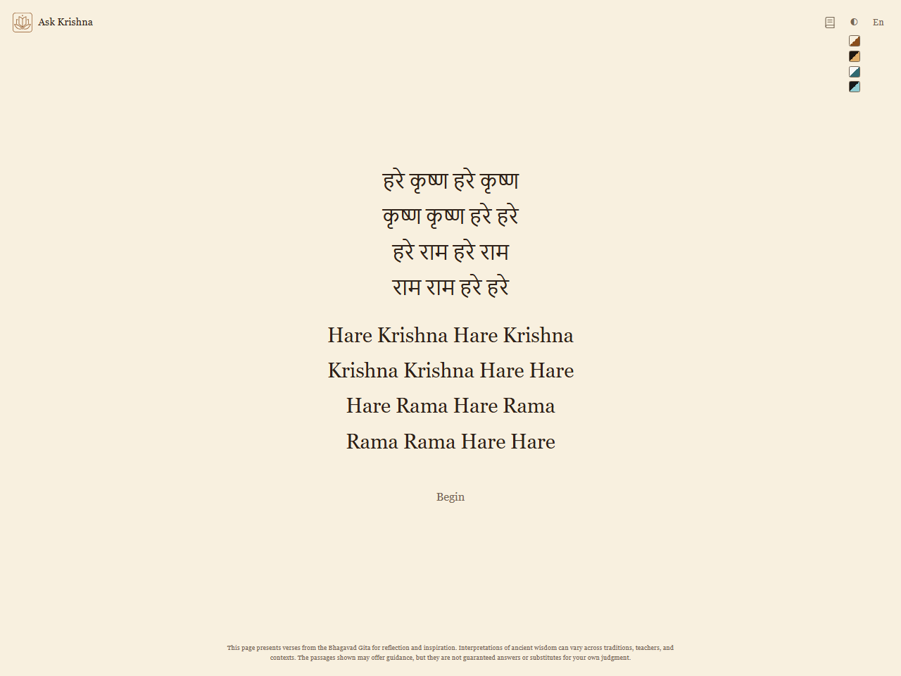
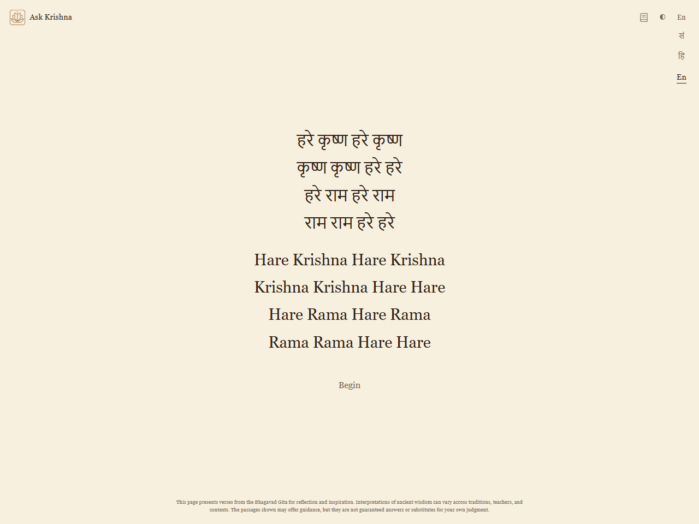
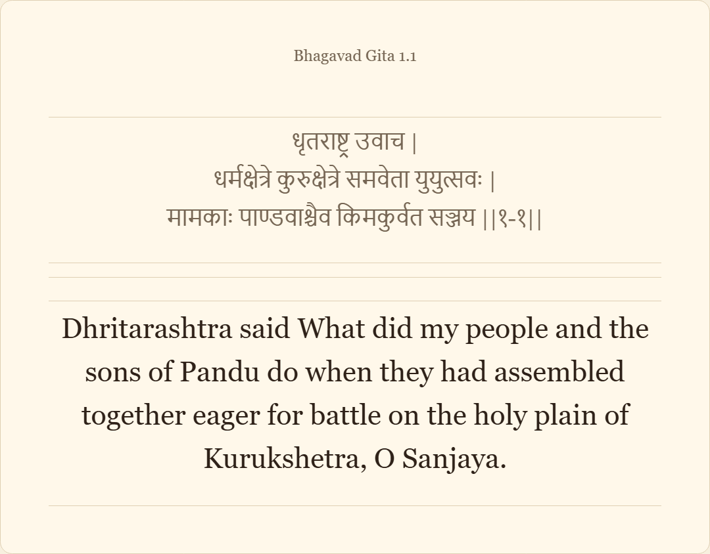

<h1>
  
  <samp>Ask Krishna</samp>
</h1>

> Speak to Krishna, in silence.

**Live site:** [hiteshgoyal.me/ask-krishna](https://hiteshgoyal.me/ask-krishna/) (GitHub Pages)

Ask Krishna is a quiet way to reflect with the Bhagavad Gita, and to read it, in two flows:

1. **Reflect** — begin from the Hare Krishna mahamantra, sit through a purification pause, hold a question silently, and receive five three-verse passages one at a time.
2. **Read Gita** — browse all 18 chapters (701 verses in this edition) one at a time, with Sanskrit text, translations, marks, and resume where you left off.

It is plain HTML, CSS and JavaScript with no accounts and no server to run. Your theme, language, bookmarks and reading position stay in your browser. Verse text and UI strings load from JSON files when needed.

## Screenshots

Full-page captures at 1280×960. Theme and language vary by screen; assignments live in `assets/screenshots/capture-plan.json` (chosen on the first run, then kept). Regenerate:

```sh
python3 -m http.server 8000
npm install playwright --no-save
node scripts/capture-screenshots.mjs
```

Reflect: Begin → settings → Purify → Hold → Passage → Save or wait.

<table>
  <tr>
    <td align="center" valign="top">
      <strong>Start</strong><br />
      
    </td>
    <td align="center" valign="top">
      <strong>Theme picker</strong><br />
      
    </td>
    <td align="center" valign="top">
      <strong>Language picker</strong><br />
      
    </td>
  </tr>
  <tr>
    <td align="center" valign="top">
      <strong>Purification</strong><br />
      
    </td>
    <td align="center" valign="top">
      <strong>Hold · Vedic Dark · English</strong><br />
      
    </td>
    <td align="center" valign="top">
      <strong>Passage · Vedic Light</strong><br />
      
    </td>
  </tr>
  <tr>
    <td align="center" valign="top">
      <strong>Wait</strong><br />
      
    </td>
    <td align="center" valign="top">
      <strong>Saved PNG · Modern Light</strong><br />
      
    </td>
    <td></td>
  </tr>
</table>

Read Gita: verse index, reader, marks.

<table>
  <tr>
    <td align="center" valign="top">
      <strong>Verse index · Modern Dark</strong><br />
      
    </td>
    <td align="center" valign="top">
      <strong>Reader</strong><br />
      
    </td>
    <td align="center" valign="top">
      <strong>Marked verse · Hindi</strong><br />
      
    </td>
  </tr>
  <tr>
    <td align="center" valign="top">
      <strong>Index with marks · Sanskrit UI</strong><br />
      
    </td>
    <td align="center" valign="top">
      <strong>Saved PNG</strong><br />
      
    </td>
    <td></td>
  </tr>
</table>

## Features

- **Quiet reflection flow** — mahamantra → purification pause → silent question → five three-verse passages → wait-and-ponder cue.
- **Read the Gita** — purification pause → remember Krishna → verse index (marked verses at top) → one verse per page with prev/next and a mark toggle. Open from the book icon in the top bar or go to [`pages/read.html`](pages/read.html).
- **Save as PNG** — any single reflection passage or the whole session, rendered in-browser to themed cards.
- **Multilingual** — UI strings and verse translations are lazy-loaded per language; ships with Sanskrit, Hindi, and English.
- **Four themes** — Vedic Light/Dark and Modern Light/Dark; respects `prefers-color-scheme`.
- **Simple to host** — plain HTML, CSS, vanilla JS. `localStorage` and `sessionStorage` for state. No backend, framework, bundler, accounts, or sync.

## Flows

### Reflect (home)

1. Begin.
2. Sit through a short purification pause.
3. Hold a question silently.
4. Browse five three-verse Bhagavad Gita passages one at a time.
5. Save the passage that feels like the answer as a PNG card, or move past the last passage for a wait-and-ponder cue.

### Read Gita

1. Open from the book icon or [`pages/read.html`](pages/read.html).
2. Purification pause, then remember Lord Krishna.
3. Choose a verse from the index — marked verses appear at the top — or continue where you left off.
4. Read one verse at a time; save it as a PNG card, mark it, or return to the index.

## Run locally

Serve the repository root with any simple file server:

```sh
python3 -m http.server 8000
```

Then open `http://localhost:8000`.

There is no backend, database, framework, or package install. The only script to remember is the search-pages one below, after data changes.

Theme and language settings are saved in `localStorage`. Clicking the top-left title returns home from Read Gita, or resets the reflection flow on the home page.

UI strings live as one JSON file per language under `assets/locales/<code>.json`. `assets/i18n.js` is a small manifest plus a lazy loader, so adding a language is one new locale file plus one manifest line.

Saved reflection passages are rendered in-browser as PNG cards; no image service or build step is used.

## Search pages (run after data changes)

Search engines and link previews get their own plain pages, generated from the same data the app uses:

- `pages/chapter-1.html` … `pages/chapter-18.html` — every verse of one chapter in Sanskrit, with English and Hindi meanings, plus links into the reader.
- `sitemap.xml` — home, reader and the 18 chapter pages. A page's `lastmod` only changes when its content changes (hashes live in `data/seo-manifest.json`).
- The marked chapter list in `llms.txt`, and the marked JSON-LD and no-JavaScript chapter list in `pages/read.html`.

Chapter names, page title and description patterns, and the share image live in `data/seo-config.json`. After changing anything in `data/`, the meta or sacred strings in `assets/locales/`, or that config, run:

```sh
node scripts/build-seo.mjs
```

To confirm nothing is out of date (exits 1 and lists the files if something is):

```sh
node scripts/build-seo.mjs --check
```

It uses Node's built-in modules only. Do not edit the generated files or the marked regions by hand; the next run would overwrite them.

## Deploy

Published via GitHub Pages at [https://hiteshgoyal.me/ask-krishna/](https://hiteshgoyal.me/ask-krishna/). SEO files (`robots.txt`, `sitemap.xml`, `llms.txt`) and canonical URLs point to that base path.

## Data

The verses are split across `data/verses.json` (verse structure plus Sanskrit) and `data/translations/<code>.json` (per-language verse translations). Both are normalized from the Hugging Face dataset `Voider22/bhagavad-gita-verses-sanskrit-translations`, which attributes the source to VedicScriptures and includes MIT license terms. Adding a new verse language is just dropping a new `data/translations/<code>.json` file.

See `NOTICE.md` for dataset source, selected translation fields, author attributions, and license notice.

The optional converter is:

```sh
python3 scripts/normalize_gita.py /path/to/gita.jsonl data/
```

The converter writes `data/verses.json`, `data/translations/{hi,en}.json`, and `data/normalization-log.jsonl` for suspicious text cleanup events.

## License

The app code is MIT licensed. Dataset attribution and license details are kept separately in `NOTICE.md`.
