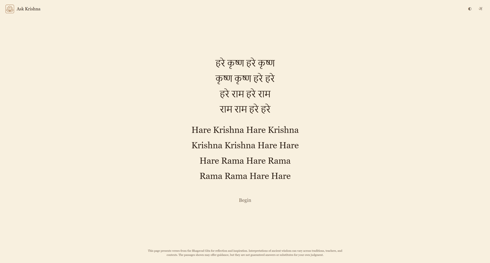
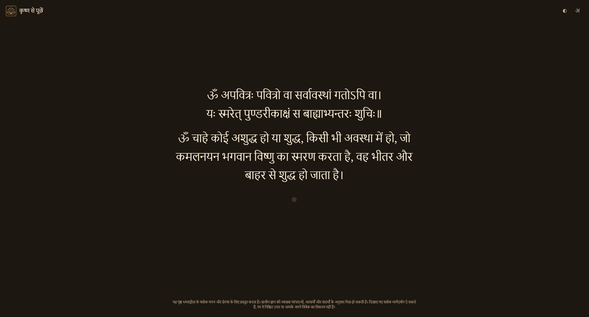
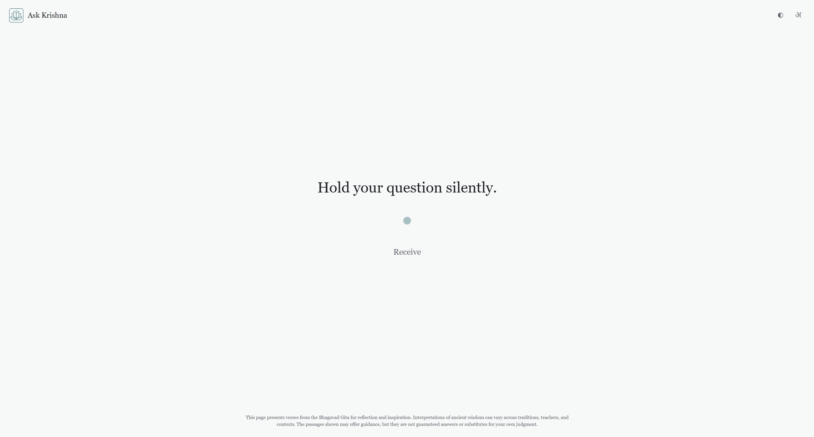
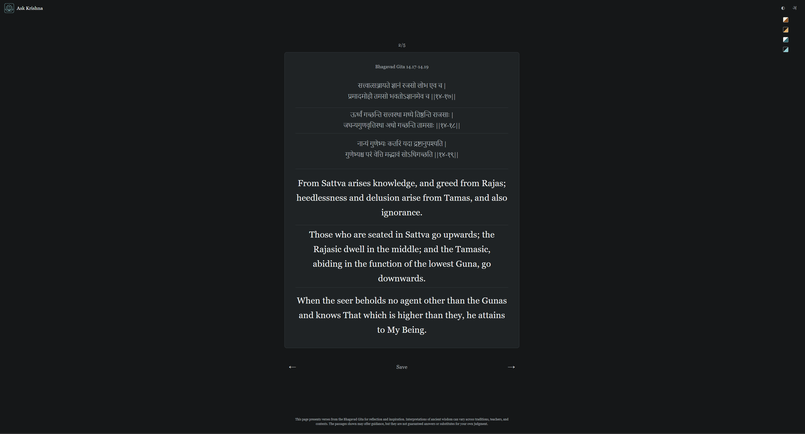
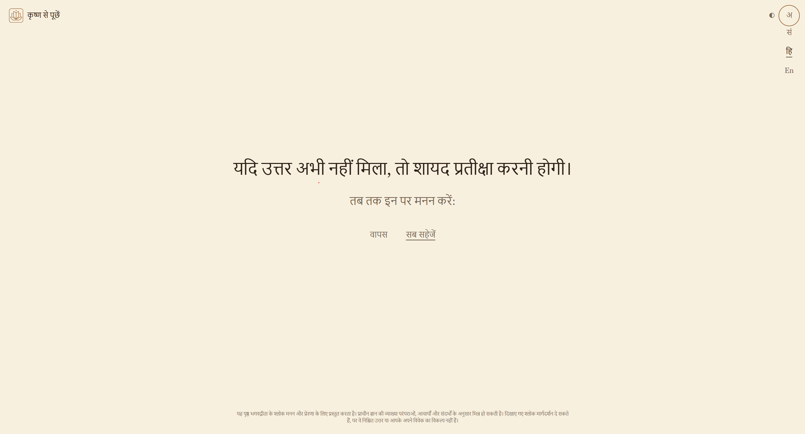
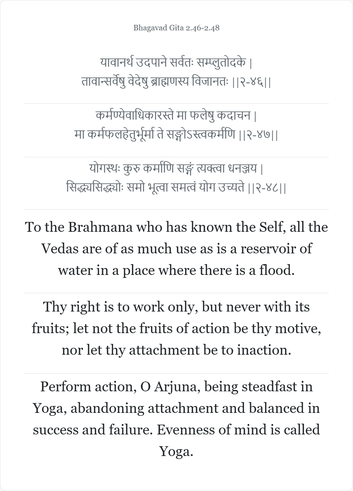
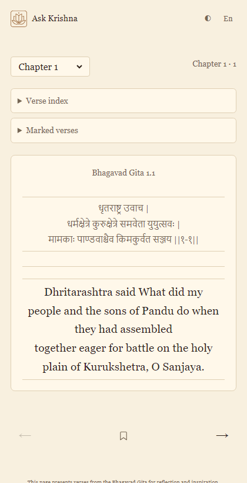
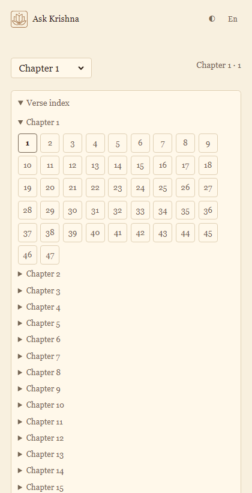
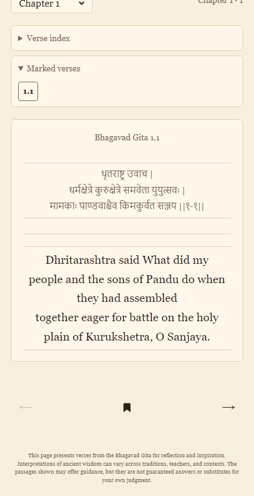
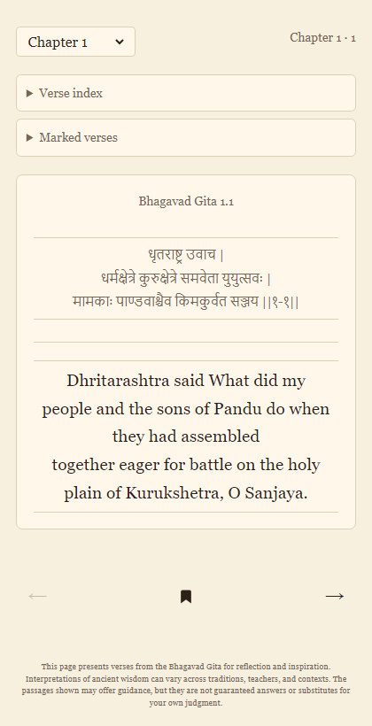

<h1>
  
  <samp>Ask Krishna</samp>
</h1>

> Speak to Krishna, in silence.

**Live site:** [hiteshgoyal.me/ask-krishna](https://hiteshgoyal.me/ask-krishna/) (GitHub Pages)

Ask Krishna is a serverless, local-first Bhagavad Gita app with two quiet flows:

1. **Reflect** — begin from the Hare Krishna mahamantra, sit through a purification pause, hold a question silently, and receive five three-verse passages one at a time.
2. **Read Gita** — browse all 700 verses one at a time, with Sanskrit text, translations, marks, and resume where you left off.

It is designed as clean static pages: no backend, no account system, no sync, no build step. Theme and language preferences live in `localStorage`. Verse text and UI strings load from static JSON on demand.

## Screenshots

Reflect: Begin → Purify → Hold → Receive → Save or wait.

<table>
  <tr>
    <td align="center" valign="top">
      <strong>Start</strong><br />
      
    </td>
    <td align="center" valign="top">
      <strong>Purification</strong><br />
      
    </td>
    <td align="center" valign="top">
      <strong>Reflect</strong><br />
      
    </td>
  </tr>
  <tr>
    <td align="center" valign="top">
      <strong>Passage</strong><br />
      
    </td>
    <td align="center" valign="top">
      <strong>Wait</strong><br />
      
    </td>
    <td align="center">
      <strong>Saved PNG</strong><br />
      
    </td>
  </tr>
</table>

Read Gita: verse index (with marks), reader.

<table>
  <tr>
    <td align="center" valign="top">
      <strong>Reader</strong><br />
      
    </td>
    <td align="center" valign="top">
      <strong>Verse index</strong><br />
      
    </td>
    <td align="center" valign="top">
      <strong>Marked list</strong><br />
      
    </td>
  </tr>
  <tr>
    <td align="center" valign="top">
      <strong>Marked verse</strong><br />
      
    </td>
  </tr>
</table>

## Features

- **Quiet reflection flow** — mahamantra → purification pause → silent question → five three-verse passages → wait-and-ponder cue.
- **Read the Gita** — purification pause → remember Krishna → verse index (marked verses at top) → one verse per page with prev/next and a mark toggle. Open from the book icon in the top bar or go to [`pages/read.html`](pages/read.html).
- **Save as PNG** — any single reflection passage or the whole session, rendered in-browser to themed cards.
- **Multilingual** — UI strings and verse translations are lazy-loaded per language; ships with Sanskrit, Hindi, and English.
- **Four themes** — Vedic Light/Dark and Modern Light/Dark; respects `prefers-color-scheme`.
- **Fully static, local-first** — plain HTML, CSS, vanilla JS. `localStorage` and `sessionStorage` for state. No backend, framework, bundler, accounts, or sync.

## Flows

### Reflect (home)

1. Begin.
2. Sit through a short purification pause.
3. Hold a question silently.
4. Browse five three-verse Bhagavad Gita passages one at a time.
5. Save the passage that feels like the answer as a PNG card, or move past the last passage for a wait-and-ponder cue.

### Read Gita

1. Open from the book icon or [`pages/read.html`](pages/read.html).
2. Purification pause, then remember Lord Krishna.
3. Choose a verse from the index — marked verses appear at the top — or continue where you left off.
4. Read one verse at a time; save it as a PNG card, mark it, or return to the index.

## Run locally

Serve the repository root with any static file server:

```sh
python3 -m http.server 8000
```

Then open `http://localhost:8000`.

There is no backend, database, framework, package install, or build step.

Theme and language settings are saved in `localStorage`. Clicking the top-left title returns home from Read Gita, or resets the reflection flow on the home page.

UI strings live as one JSON file per language under `assets/locales/<code>.json`. `assets/i18n.js` is a small manifest plus a lazy loader, so adding a language is one new locale file plus one manifest line.

Saved reflection passages are rendered in-browser as PNG cards; no image service or build step is used.

## Deploy

Published via GitHub Pages at [https://hiteshgoyal.me/ask-krishna/](https://hiteshgoyal.me/ask-krishna/). SEO files (`robots.txt`, `sitemap.xml`, `llms.txt`) and canonical URLs point to that base path.

## Data

The verses are split across `data/verses.json` (verse structure plus Sanskrit) and `data/translations/<code>.json` (per-language verse translations). Both are normalized from the Hugging Face dataset `Voider22/bhagavad-gita-verses-sanskrit-translations`, which attributes the source to VedicScriptures and includes MIT license terms. Adding a new verse language is just dropping a new `data/translations/<code>.json` file.

See `NOTICE.md` for dataset source, selected translation fields, author attributions, and license notice.

The optional converter is:

```sh
python3 scripts/normalize_gita.py /path/to/gita.jsonl data/
```

The converter writes `data/verses.json`, `data/translations/{hi,en}.json`, and `data/normalization-log.jsonl` for suspicious text cleanup events.

## License

The app code is MIT licensed. Dataset attribution and license details are kept separately in `NOTICE.md`.
